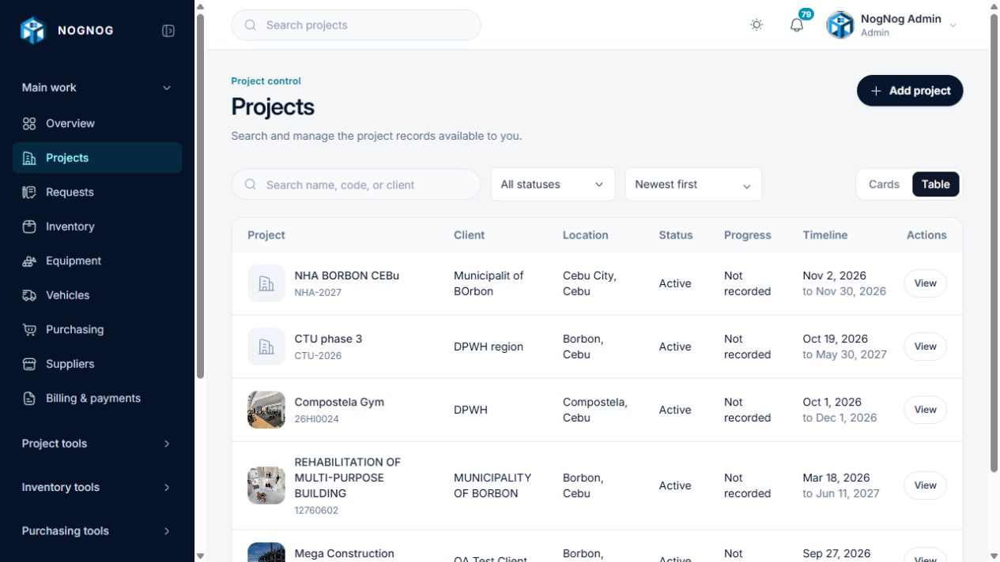
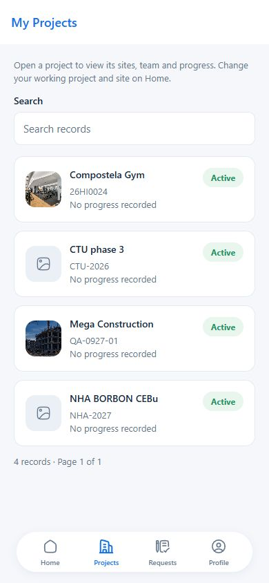

# Registry and record readability review — 13 November 2026

Names are the primary label; codes are secondary text on their own line. The shared identity component is used by project/request/billing/material tables and context headers. Select options carry separate name/code fields, and searching still matches both. Existing code-first reference RPC responses are adapted for display without changing identifiers or posting contracts. Mobile record summaries use separate lines for code, dates, units and status.

## Data loading changes

- Asset locations are searched on the server in 20-result pages, debounced and cancelled when superseded. The saved selection can be resolved independently of the current search page. Failed searches show Retry; typed query text cannot become a saved ID.
- Account/project/employee/site editor selectors use the same paged control and authenticated GET endpoint. Project/site choices retain active-project/site and role restrictions; full employee names and complete email addresses remain searchable. Editor references load only when searched.
- Employee assignment, rate, record and attendance histories now use independent 20-record pages. The Admin/Finance attendance section displays real posted rows and audited reversals instead of a fixed empty message. Other roles do not see a misleading empty attendance section. Historical project/site names are resolved by ID, including completed projects; linked inactive accounts no longer disappear merely because they are absent from active choices.
- Equipment/vehicle list and detail hydration resolves only locations referenced by the loaded records/history. Removed the obsolete full-location form props and reference loader.
- Users has server-side name/email search and a unique ordering tie-breaker. Removed the 25,000-account UI ceiling. Pagination still uses offsets; this is not a cursor implementation or a measured hosted 100,000-account benchmark.
- Inventory, equipment and QR CSV exports stream batches. The explicit 20,000 QR export limit is removed. Cancellation closes the export iterator; spreadsheet formula prefixes remain escaped.
- Project detail/list references now use stable batches, resolve assigned staff by ID, and avoid fetching unrelated accounts. Completed-project names remain visible in employee history.
- Request detail reads use bounded pages/ID batches for complete approval, tracking, source-stock, fulfillment and reference data. Display histories retain chronological order across ID batches. Line/item lookups use maps instead of repeated full scans. The complete request remains available to its existing review flow.
- Monthly material consumption is aggregated by month/material/unit in PostgreSQL. Reversed consumption is excluded. The function uses invoker rights, existing grants and RLS; stock/cost posting commands are unchanged.

## Database rollout

Apply `supabase/migrations/20261113100000_scalable_registry_and_chart_reads.sql` to staging before deploying dependent web code. It adds two read functions and a partial consumption-date index. It does not delete tables or records or rewrite prior migrations. The user confirmed staging application. The location search and monthly consumption functions were then verified against staging for Admin, Finance, Engineer, Foreman and Warehouse. Each chart result reconciles with that role’s visible unreversed ledger. The local production dashboard loads the chart against staging successfully.

## Verification

- Web: 183 unit/domain tests passed, including 100,000-row streaming CSV coverage, cancellation, formula escaping and name/code search.
- Full migration-chain fixture: 12,005 locations, deep pagination, last-record search, selected-ID lookup, invalid input, anonymous denial and five-role RLS parity passed. Chart totals match unreversed ledger consumption for five roles; real consumption/reversal commands are exercised.
- 42 isolated PostgreSQL workflow checks passed, covering request approval/retry, competing dispatch, partial receipt/correction, cost reconciliation, billing, purchasing and denied-role access.
- Attendance evidence suite passed: QR verification before a fresh photo, cancellation, expiry/old-photo rejection, correct worker/private evidence, concurrent retries and replaced-card denial.
- Driver/asset expense suite passed: one truck per driver/shared shifts, reassignment races, own-history access, retries, receipt isolation and audited reversals without project double-counting.
- With `ERP_TEST_REGISTRY_SQL_APPLIED=1`, the HTTP suite also verifies location searches, selected-ID resolution and chart/ledger reconciliation for all five roles against staging.
- Reference HTTP checks against the local web server and authorized staging accounts passed for Admin, Finance, Engineer, Foreman and Warehouse: bounded results, multiword employee-name search, invalid inputs, role denial and no-store responses.
- Browser checks confirmed real employee attendance, retained detail context while editing, discard handling, query-only cancel without a false discard prompt, and name/code project search.
- The aggregation query plan in the isolated fixture uses the new partial date index and existing reversal index. This is not a hosted throughput benchmark.
- Mobile: typecheck, lint, 31 tests and web export passed. These checks do not replace Android camera/print acceptance or create a new signed AAB.

## Remaining release evidence

Staging migration and live location/chart checks passed on 13 November 2026. Not every historical ERP screen has been visually accepted for every role. Remaining whole-company project-management/filter reference lists and project-wide workforce summaries still need separately measured scaling work; this change does not certify that all screens can render 100,000 rows at once. Keep database paging and bounded UI lists rather than removing safe page sizes. No company data, migration history, or stored optional field values were deleted as cleanup.

## Review screenshots

Desktop project table: 

Engineer phone-sized browser preview (not a physical Android test): 

The browser-only mobile review used a local same-origin proxy to the existing ERP mobile API. Production access settings and app environment files were not changed. The preview export is a development artifact, not an installable release.
