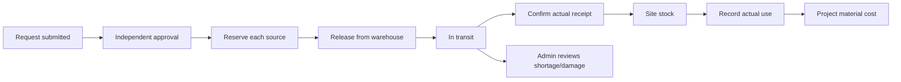

# Workflow map: states, actions and recovery

This is the navigation map for developers and coding agents. It describes implemented flows, not new business policy. PostgreSQL commands and RLS remain authoritative. UI guidance must use existing capabilities and quantities, never authorize a transition itself.

Run `npm run audit:workflows -- ../output/workflow-qa-20261111/state-inventory.json` to inventory current TypeScript status unions, React state/reducer/mutation hooks, and status comparisons across web and mobile. The initial scan covered 554 files, 44 status declarations, 463 controls and 334 comparisons. These overlap; they are not 463 independent business machines. The inventory supplies source file/line references. It is a static discovery aid, not proof that every possible runtime path is safe.

## Business state families

| Family | States / progression | Authority and guard |
|---|---|---|
| Account | invited → onboarding → active; inactive blocks access | Auth/profile/user-role checks, `guard_mobile_api`, RLS; no peer-Admin invitation/escalation |
| Project | draft, active, on hold, completed, cancelled; archived is separate | Project commands; memberships and active sites govern operational access |
| Project/site selection | restoring → none → loading → valid; transient stale vs revoked | Mobile `project-provider`, `project-context`, `resource-state`; never keep revoked context |
| Project and warehouse assignments | active ↔ inactive; worker assignments end/transfer by date | Assignment commands plus effective dates; UI selection is not authorization |
| Materials/catalog | active/archive; legacy reusable material records remain historical | Material commands; equipment is a separate asset lifecycle |
| Material sourcing | submitted → resolved/dismissed | Missing-material/sourcing commands with resolution links |
| Request approval | submitted → approved/partially approved/rejected; cancellation where allowed | `decide_material_request_sources`, cancellation RPCs; independent Engineer or Admin; same-key retries |
| Per-warehouse reservation | active → fulfilled/released | Reservation ledger, row locking; decreases available, not on-hand |
| Physical delivery | ready → released/in transit → partial receipt → accounted for | Per-allocation and transfer-item quantities; cannot sum different material units to infer completion |
| Transit variance | outstanding → Admin-approved missing/damaged | Variance RPC, immutable reason/actor; not a normal receipt |
| Undispatched remainder | reserved → explicitly closed | Close-remainder command; does not pretend undelivered stock arrived |
| Site stock and use | receipt adds stock → consumption/return reduces it | Inventory movement commands and purchase batches; project material cost posts at consumption |
| Stock counts/corrections | draft/count → approved adjustment; original → reversal | Authorized adjustment/reversal RPC; retain the original ledger and reason |
| Purchase order | submitted/ordered → partial receipt → received; cancellation | PO/inspection/receipt commands; prices and costs remain snapshots |
| Delivery inspection | delivered → accepted/rejected portions → stock receipt | Inspection and receipt are atomic where combined; retries do not create duplicate stock |
| Supplier payment | unpaid → partly paid → paid | Supplier payment command and outstanding balance, independent of delivery status |
| Site purchase/receipt | submitted → approved/rejected; item stock entry separately tracked | Receipt approval/posting commands; never post linked project expense twice |
| Reimbursement | eligible → outstanding → reimbursed | Finance/Admin reimbursement command; distinct from supplier payment |
| Equipment request | submitted → approved/rejected → checked out → returned | Equipment decision/handover/return commands; approval alone is not physical handover |
| Asset condition/location | available, assigned, in use, maintenance, out of service, retired | Asset event/custody commands; do not infer status solely from expense history |
| Driver assignment | unassigned ↔ one current truck; a truck may have multiple drivers | Assignment RPC; stale open forms rejected; own prior expenses remain visible |
| Asset expense | submitted/posted → audited reversal | Immutable asset ledger; retries once; asset expenses do not automatically post project costs |
| Worker identity | employee record + current QR; replaced card becomes invalid | Current-card and active/date/site checks; worker self-service accounts remain an unapproved product decision |
| Attendance capture | QR verification → identity review → camera → photo review → scan save | `prepare_attendance_scan`, private upload, `record_attendance_scan_with_photo`; cancel/expiry creates no scan |
| Attendance and cost | time-in → time-out → reviewed hours → posted; Admin reversal | Attendance batch command/rate snapshot. No automatic eight hours from unfinished scan; missing rate is not absence |
| Equipment usage | photos/hours prepared → posted → audited reversal | Existing usage-with-photos command; effective rates, once-only historical cost |
| Project expense/budget | expense posted/reversed; budget adjustment adds audited delta | Budget minus net posted costs; zero/under/over budget are derived display states, not editable statuses |
| Invoice/payment | issued → partial payment → paid; authorized void | Invoice/payment allocation commands; contract/billing values remain separate from approved budget |
| Payroll | draft → finalized → paid; authorized void | Payroll RPC; does not add the same labour cost to projects again |
| Daily report | draft → submitted → approved or requires revision → corrected draft | Shared `dailyReportActions`; author cannot self-review. SQL accepts review only from submitted. Legacy pending_review/rejected records do not gain invented transitions |
| QR registry | active → inactive/replaced | Identifier lookup still checks access; labels never carry authorization or prices |
| Notifications | unread → read; delivery outbox pending/retry/delivered/failed | Inbox reads are safe optimistic UI; stock/money posting is never optimistic |

The actual SQL spellings and any additional historical enum values are in migrations and the generated database types. Older README diagrams contain conceptual stages (e.g. UNDER_REVIEW/CLOSED) that are not necessarily stored enum values. Do not create status strings from a diagram.

## UI and asynchronous state families

| Family | Rules |
|---|---|
| Resource loading | No data + fetching = loading; paused offline = connection message; resolved zero records = empty |
| Cached refresh | A transient failure retains validated cached content with a visible warning; 401/403/404/426 blocks cached details. Disabled scoped lists must not render old rows |
| Submission | editing → sending → confirmed, known rejection, or unconfirmed result. No automatic retry of posted stock/money |
| Unconfirmed result | Driver/warehouse forms retain the exact command, date, photo and key and lock edits. Retry the same command; do not silently create a new key |
| Validation rejection | Keep typed values; allow corrections when the server definitely rejected the request. An earlier unconfirmed result stays protected even after a later 4xx |
| Modal/confirmation | idle → open → confirming → submitting → result. Block close/escape while submitting; important actions have visible text |
| Camera/photo | permission → ready → capture/prepare → review → upload/save. No camera requests on mount; capture/retry pair remains bound to the verified worker |
| Daily report composition | draft save → verify existing posted activity → link/detach → optional photo → submit; recover lost response by reading the existing report. Links do not re-post costs |
| Search/pagination | scope + filters + page form query identity; reset page when filtering; keep selection only within the correct scope |
| Live sync | connected → batched refresh; disconnected → foreground polling/backoff; reconnect → reconcile. A realtime event is not posting confirmation |
| Compatibility | compatible, temporary metadata failure, confirmed update required, backend outdated. A connection error is not proof that an app update is mandatory |

## Code entry points

- Shared display/action guidance: `packages/domain/src/workflow-guidance.ts`; web request delivery import remains a compatibility re-export. This avoids divergent web/mobile status meanings.
- Mobile readable/error state: `src/lib/resource-state.ts` in the mobile repository.
- Mobile retry outcome: `src/lib/submission-recovery.ts`; used by Driver expenses and Warehouse receive/release. It is not an offline outbox. Closing/reinstalling the app does not promise durable recovery: check history before re-entering an uncertain operation.
- Web Purchasing: `src/lib/purchasing/workflow.ts` computes the allowed primary action; `purchase-workflow-cell.tsx` shows a readable action instead of an unexplained pencil.
- Business source of truth: relevant functions under `supabase/migrations`; regression suites listed in `package.json`.

## Before changing a flow

1. Identify whether the state is stored, derived from quantities, a capability, or a temporary UI state. Do not merge these.
2. Locate the current SQL command and its guards; check the latest migration rather than only the original definition.
3. Match UI actions to those guards. Test self-review, another site/warehouse, terminal states, stale assignment and invalid status.
4. For writes, test lost response/concurrent retry and reconciliation. Keep posted values immutable; use audited corrections.
5. Run the audit, relevant tests and visual checks; record what was actually exercised. Do not equate static inventory or passing unit tests with every device/workflow being accepted.

Worker-account self-service, new approval tiers, automatic break/overtime rules, biometric matching, offline posting and retention policy are not silently introduced by a UX cleanup.

## Contextual record panels

The web uses the existing `@modal` parallel slot and explicit intercepting detail routes. A list link opens `closed → loading → ready` in `RecordDetailPanel`; a failed load provides retry/close, and an unavailable record retains the canonical page's access checks. Direct links and refresh render the canonical full page. The intercepted wrapper imports that same server page: never duplicate its queries, permissions or posting commands in a client preview API.

Close and Escape use router history to restore the source list, including its filters. Native dialogs provide focus containment. A nested dialog's Escape must close only that dialog. Cleanup closes the native element without navigating again. Do not add a second router-back handler to `onClose`.

Loading boundaries belong to the intercepted `[id]` segments, not the entire modal slot: closing a record must not show a new loading drawer while the list returns. Streamed loading/ready panels may overlap; `lockBodyScroll` reference-counts their locks and restores scrolling after the final owner closes, regardless of cleanup order.

Submitting is distinct from an invalid draft. The panel watches `aria-busy` on its forms/controls and disables Close for an in-flight save. New inline posting forms must expose their pending state; the shared `RecordFormControls` already does so. Ordinary nested editing dialogs and pending saves defer background refresh. A read-only detail panel does not freeze live stock/status updates; `shouldDeferRouteRefresh` owns that distinction and has regression coverage.

Closed `RecordCreateDialog` instances do not keep form controls mounted. Open mounts a fresh keyed form; Cancel/Close unmounts it; a new opening starts with saved values. Keep the existing initial-open URL and completed/cancelled close behavior intact. This prevents hidden forms from competing for generic field IDs and label focus. Popup menus store their portal host when opened and render inside the closest native dialog; their Escape handler closes the menu without dismissing the record panel.

Collection tools such as New, Receive deliveries and supplier Prices have explicit null entries in the intercepted slot. This keeps their existing full routes from being mistaken for a record ID. Keep the existing intercepted New invoice flow intact. When adding a detail route, check its collection's static paths and test soft navigation, direct URL, Back/Forward, close, nested dialogs, errors and phone width.

Source selection is required for every positive approved material quantity. A request-wide warehouse applies one default to the lines; per-line allocations may use different warehouses. The visible source picker and missing-source guard must explain this distinction. Do not require a single request-wide default or move warehouse choice into an unauthorized requester role as a copy/layout change. Approval reserves; release deducts; site receipt and actual use remain separate commands.

## Money entry and visible action dialogs

`MoneyInput` groups the integer part for display without numeric coercion, truncation or rounding. Its named hidden field and `onValueChange` use the ungrouped decimal string. Use it for all web money inputs; keep stock quantities, hours, identifiers and dates in their existing controls. Server decimal schemas, maximums, balance checks and transactional commands remain authoritative. Controlled calculations must use the raw callback, never parse the grouped display string. The shared peso wrapper uses the same component. Regression tests cover exact values, grouped pastes, invalid text, editing caret positions, default/controlled values and disabled submission fields.

Operational `
` action forms use `ActionDialog` with an explicit button, explanation, required fields and confirmation. History, navigation, optional form sections and genuine selection dropdowns keep their existing disclosure/selection behavior. `RecordFormControls` blocks dismissal while sending and accepts `success` for actions that return a confirmed result instead of redirecting. Only a confirmed success closes the dialog. Ordinary cancelled dialogs unmount their drafts; errors keep the form open. Release, receipt and variance dialogs explicitly retain their scoped draft and command key across dismissal until confirmed success. This preserves the existing in-page retry behavior; it does not provide persistence across navigation or reload. Their field IDs must remain scoped to the transaction, because a retained closed draft remains mounted. **Go back** means dismiss without performing the business cancellation. Purchase workflow commands sit with View in the fixed Actions column so horizontal table scrolling cannot hide them behind View.

## Discoverable records and cost sources

Operational drilldowns use visible outlined links with a 44px minimum touch target on phones. Use descriptive text for row actions, receipts, evidence, approvals, histories and downloads; an icon supplements the label. A record-name link can remain when the row also has an explicit View action. Normal tabs, sidebar navigation, auth links and menu entries remain navigation controls.

Cost history exposes the existing all/expenses/budget views in a named navigation region. Category links retain the project ID and expense bucket. A site receipt button uses `get_project_expense_entries.receipt_id`, whose SQL join matches both the expense ID and project ID; do not infer a receipt from its display reference. Labour and equipment totals already include their receipt categories: link those sources separately, without adding their amounts to the chart a second time. Reversed rows retain their receipt source for audit and are excluded from posted totals.

Sidebar expansion follows the most specific authorized path on a navigation change. The current route can still be collapsed by the user; rendering the shell must not grant access to additional items or force it open on every render. `activeNavigationGroup` matches path boundaries and is tested against prefix collisions.

### UX refinement boundaries (2026-11-12)

Ordinary long-form dialogs may opt into `confirmDiscard`: editing then closing offers Keep editing or Discard changes. Successful completion bypasses this prompt. Pending commands remain guarded. This is separate from `retainDraft`, whose transaction payload and retry key must survive uncertain outcomes. Unscoped record selectors start blank; explicit authorized project/request/quotation context remains prefilled. Request transfer navigation uses a typed request-line foreign key rather than parsing a reference label. No workflow transition or financial rule changed.

## Unit detail presentation (2026-11-12)

`RecordSectionTabs` makes the active unit section explicit: expenses → details → project-use → history, restricted to sections already authorized by the server. These are presentation states, not asset lifecycle transitions. Inactive sections stay mounted to preserve form and retry state; the selected record ID resets the view for another unit. Query pagination selects the relevant section and replaces history inside the existing drawer. Correction remains open → reason → existing audited reversal → refreshed ledger; dismissing an unsubmitted add-expense form retains its draft. Stale counted offsets recover `PGRST103` or a successful empty counted offset to page one; other failures remain errors. See `asset-detail-ux-20261112.md`.

## Compact row actions and assignment dialogs (2026-11-12)

A record with one action shows that action directly. With two or more actions, all commands (including View) enter `closed → menu → existing confirmation/form` through one shared three-dot menu. No menu opening mutates business state. Programmatically opened retained dialogs mount their drafts on first open so closing and reopening keeps the payload/key. Equipment request and purchase workflow actions still derive from the existing status guides. Truck Add driver uses the existing `set_driver_truck` command one driver at a time and preserves other truck drivers; selecting a driver assigned elsewhere explains the move before submission. Read candidates are active onboarded driver accounts, searched by sanitized name with a 50-result bound. Server authorization and database assignment constraints remain authoritative.

Driver assignment editing is an in-place dialog in Users and the truck record, not a separate driver list or edit page. The former `/users/drivers` URL redirects to Users for bookmark compatibility. Dialog truck search is Admin-only, bounded to 50 results and ignores superseded responses; the hidden submitted asset ID is empty for assignment removal. Existing `set_driver_truck` serialization and one-active-truck constraints remain unchanged.

## Archive confirmation and print navigation (2026-11-12)

Employee, supplier, material and employee-category archive commands enter `closed → confirmation → pending → existing archive/redirect` instead of posting immediately or exposing inline reason inputs. Expected category guard failures return to the open form with feedback. Project assignment ending also opens its existing date/reason form in a dialog. Pending state blocks dismissal. Worker ID-card printing enters `closed → loading → preview/error → print or close` in a dialog without navigating. It loads authorized cards lazily; failures offer Retry. The legacy print URL reuses the same loader/layout. No new page or iframe is introduced, and frame protections remain intact. Genuine record missing/access denials still use the guarded unavailable panel. No SQL lifecycle transition changed.

## Employee jobs / trades in place (2026-11-12)

The Employees action now opens a Jobs / trades dialog: list → add/edit/archive → pending → existing command → close and revalidated Employees. Two row actions share one three-dot menu. Save no longer redirects to a category page; the existing SQL category foreign keys and archive guards remain unchanged. The old `/employees/categories` URL redirects to Employees with the dialog open, preserving a validated edit ID for bookmarks. No separate category management screen remains.

## Payroll presentation and dialog ordering (2026-11-12)

Payroll draft rows show saved amounts, with one Edit action opening the existing earnings/deductions form in a compact dialog. Save closes on success; errors stay visible. Finalize, payment and void commands use the same guarded dialog controls. Existing SQL commands, totals and role gates are unchanged. Record drawers now enter the browser top layer during layout, before auto-opened child forms run their passive effects, preventing the details drawer from covering Edit. Employee edit dialogs are keyed by employee ID rather than updated timestamp, preserving action state across revalidation; successful employee creation closes its form before navigating to the new record. Departments retain Add and Rename; no removal command or migration is included.

## Notification preview and remaining record panels (2026-11-12)

Notifications enter list/bell → preview → close or related record. Opening the preview does not change read state. Mark as read keeps the existing owner-scoped server command; errors remain in the dialog and the badge updates only after confirmation. A related-record action closes the preview before using the existing route, allowing its contextual drawer to open. Bell previews are siblings of the closed bell menu so closing the dropdown does not hide the active dialog. Old notification detail URLs validate recipient access and redirect into the inbox preview. QR labels, supplier quotations and purchase approvals now have contextual route adapters reusing canonical content and authorization; core module screens remain workspaces. Existing record actions and status rules are unchanged.

## Scalable staff reads and simplified forms (2026-11-12)

Attendance filters run before pagination on the server; links preserve date/project/search/status. Payroll display pagination is independent from complete numeric SQL totals and batched CSV export. These are read-state changes, not payroll lifecycle transitions. Long edits use stable record identities and dirty-draft guards. New employee reference loading is open → loading → ready/error → existing save command. Inventory removes redundant presentation while preserving balances and reservations. Mobile notifications enter list → preview → explicit mark read or record navigation; errors remain visible and pending actions lock dismissal.

## Readable record labels (2026-11-12)

RecordFacts separates typed labels and values for detail headers and contextual metadata. Warehouse rows expose location, total stock and available quantities in aligned fields, including units. No string splitting is used to infer fields or change data. Record links, stock scopes, permissions and workflow commands remain the same. Mobile delivery and scan summaries use named fields/lines rather than concatenated status sentences.

## Project Finance navigation

Project Finance owns the budget summary, visual category breakdown, cost-entry dialogs, expense records, equipment-hour history and budget-change history. There is no separate cost-management screen. Legacy `/projects/:id/costs` bookmarks redirect to the project's Finance tab, preserving expense filters, pagination and posted-result messages. Expense and equipment records remain directly below the chart; the chart has no duplicate navigation buttons. The existing protected export/evidence routes and attendance workflow remain unchanged.

The read layer keeps histories paginated. Corrections still call the existing server-validated reversal command; moving a form does not change its authorization, reference or idempotency key. Single row actions remain visible; multiple expense actions share the three-dot menu. Budget changes and successful cost commands return to Finance.
